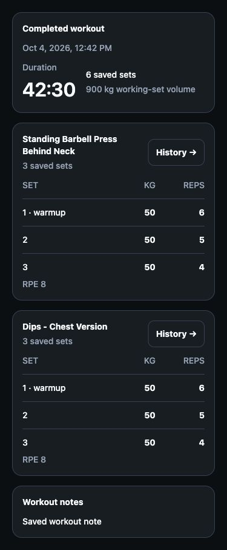
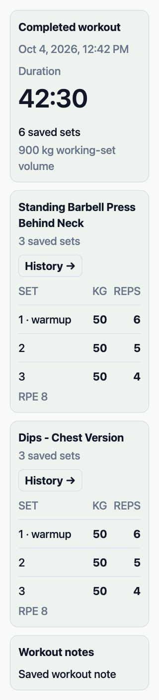

# Completed workout review — 2026-10-07

Issue [#226](https://github.com/AdamHikl/mizyun/issues/226); requirements TRAIN-01–03 and WO-07. Implemented locally. The installed app, Dev backend and Production have not changed in this package.

## Result

Completed routine and one-time strength workouts open a saved-workout review with one Close action, the recorded completion date/time in the device locale, a fixed start-to-completion duration, saved set count, working-set volume and notes. Exercise History remains available. Its existing progression sheet still permits an explicit future target change; the completed workout itself has no editing controls.

The review has no live pulse, pending set row, weight/reps input, Log Set, set-type picker, deletion checkmark, reorder arrows, Add Exercise or Discard Session. It preserves saved weight/reps, duration/distance/RPE, set types and sets whose exercise record is unavailable. Warmups remain visible and excluded from the labelled working-set volume, matching active-workout volume semantics. Historical rows no longer repeat their current values under a misleading Previous heading. Empty workouts use historical copy.

Completed records are rejected by active logging, deletion, finish and discard callbacks. Reviewing history does not synchronize or expire another workout's rest timer, clear its context, or dismiss its notification when preferences resolve. Explicit-record navigation skips unsaved workout drafts and does not become a new-workout editor after a load failure. History viewing does not start an aborted workout logging metric. A successful completion returns the saved API record and switches the retained screen to review immediately while the optional sharing prompt stays open. API/schema and Health export eligibility/consent are unchanged; optional export failure still does not fail the saved workout.

## Verification

- Baseline: the new completed routine and one-time regressions failed with expected Close versus received Finish; the other 21 existing screen tests passed.
- Final focused suite: `pnpm --filter @mizyun/mobile test src/features/log-workout src/features/analytics src/features/health-exports/save-boundaries.test.ts src/features/workouts` — 276 tests across 24 files passed. The lifecycle harness executes effects and rerenders after preferences load; renderer tests check static time/date, both session modes, imperial units, recorded extra fields, unavailable exercises, empty copy, History and retained sharing.
- iOS and Android Metro exports (`pnpm --filter @mizyun/mobile bundle:check`) passed on the exact isolated source candidate; this is bundling evidence, not native interaction.
- Mobile `tsc --noEmit` passed. Owned-file formatting and diff whitespace passed after correcting a formatter second-pass change in the test fixture.
- Independent GPT-6.1 Sol/High non-author review: no blocking findings after fixing the disabled-preference notification cleanup. Reviewer independently ran 67 tests across four targeted suites and scoped diff whitespace checks. No helper wrote files or operated services.
- Full `pnpm check`: exact isolated source scope and result are recorded in the [verification summary](evidence/completed-workout-review-2026-10-07/verification-summary.json). The snapshot is based on committed CI-retirement SHA `d5c2e06b899bda993552ddb560d8b00ada73498c` plus eight owned source/test overlays. It excludes concurrent uncommitted meal-photo and Community changes. Per-file hashes must match the shared workspace before integration.

## Rendered source preview

Actual `CompletedWorkoutFeed` and `ThemedText` rendered through React Native Web with synthetic records and the repository's extracted volume/stopwatch helpers. Observed dark375px and light320px; the latter simulated 160% text by scaling rendered text font/line heights. The 320px document and scroll width both measured320, with readable wrapping and History controls. These are source-preview checks, not native Dynamic Type, VoiceOver, safe-area or device acceptance.

## Next exact action and open gates

Integrate the owned source candidate, then inspect completed routine and one-time workouts on an exact standalone Dev iPhone/Android build: Close, local date/time, fixed duration, scrolling and accessibility/large text, no active editor controls, and reviewing history while another workout/rest timer remains active. Confirm current active start/log/finish flows and retained optional sharing on that build. No native acceptance, device installation, commit/push, deployment, provider call, Store upload or Production release was performed by this package. Preserve all broader release/privacy gates in `status.md`.
