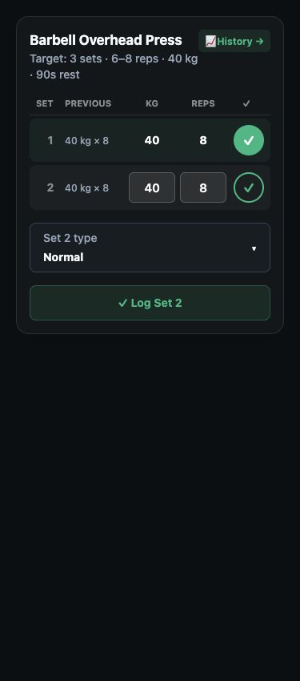
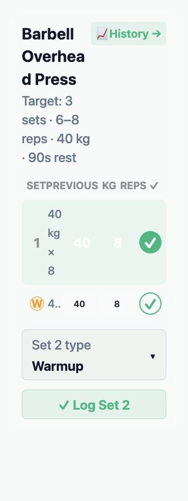

# Workout set types — #139 / 2026-10-08

## Result

The active workout already has Normal/Warmup/Failure/Drop selection and `✓ Log Set N` wording. Routine planning was subsequently implemented in d54ca07e7e93af0f19603a22ed2b9c7dd63a0fd3. That commit is not an ancestor of the latest recorded phone install source7d5c9d0ecfd52629995af25d896dd6cdfef1abaf (`git merge-base --is-ancestor` exit1), explaining why the routine controls are absent from that candidate. The actual current phone screen was not inspected.

This follow-up adds a visible `Set N type: Normal ▾` control above the Log Set button. It opens the existing picker without saving a set. It also repairs two missed boundaries from the original plan: hub working volume/top load and exercise-history volume/peak load/estimated1RM/target progress exclude warmups. Warmup history, exercise/session counts and all other set types remain intact; no formula, API or schema change.

## Verification

- Before correction, hub regression failed:3040kg vs expected2040kg. After correction the suite passed25/25.
- Helper's two progression regressions failed before correction;14/14 passed after correction. Coordinator inspected the actual diff; heavier warmup no longer earns120kg/160kg records over working75kg/88.7kg records. Raw saved set order remains visible.
- Four new visible-control cases failed before adding the control and passed afterward, including opening the correct picker without logging. Full final workout/logger focused command `pnpm --filter @mizyun/mobile test src/features/workouts src/features/log-workout`:18files/242testsPASS.
- Non-author GPT-6.1 Sol High helper reviewed coordinator control and hub diffs; no actionable finding. Helper-owned progression changes inspected by coordinator; they introduce only the existing warmup exclusion into the metric loop.
- Working tree has concurrent Community, meal, dashboard and completed-workout work. Full gate uses isolated `/private/tmp/mizyun-139-check-rn1fiikm`, baseline9e7fc4b13b54b4d0818c3b259bfef55321795f1f, with12 source overlays recorded in `issue-139-source-manifest.json`. Overlays include this follow-up and the coupled pre-existing completed-workout/logger/analytics/health-export test changes; unrelated concurrent changes are excluded. Fresh `pnpm check`PASS (exit0):1867mobile/937API tests;15credential-gated API and3legacy bundle-path config tests explicitly skipped. Both current-platform Metro export checks passed separately in this same gate. [Durable scope and result](evidence/workout-set-types-2026-10-08/check-summary-before-discoverability.json), [source hashes](evidence/workout-set-types-2026-10-08/source-manifest-before-discoverability.json). All12overlays still match the shared source after completion; log `/private/tmp/mizyun-139-check.log`.
- Simulator doctor verified the explicit iPhone17Pro UUIDF4939E5D-BA85-4479-AA1E-92B21441FB8C, initially Shutdown, and free port8087. Prior Debug binary's native manifest differs on3inputs, so it was not reused. No simulator boot/build, native interaction, physical install, backend deploy, provider call or Production release occurred.

## Phone test steps

For the currently recorded installed Dev build: Workouts → start/resume → exercise → tap the unfinished set number on the far left → Warmup → enter weight/reps → `✓ Log Set N`. Confirm amberW and one saved row; choose Normal on the next row, then Failure on the following row (redF). Finish and reopen history to confirm saved tags.

After a fresh Dev build containing the routine-planning commit and this follow-up: Workouts → Create/Edit Routine → add an exercise → Set types → choose Warmup/Normal/Failure for sets1/2/3 → Save → reopen → Start. Confirm pending types advance in that order, logging adds exactly one saved row, manual overrides survive failed-save retry, and warmups do not contribute to working volume or records. Repeat on iOS/Android with keyboard, large text and screen-reader interaction. Physical standalone/native acceptance remains open; keep #139 active.

Next exact action: install a fresh Dev mobile candidate and perform the routine save/reopen/start/log/finish/history journey above. The existing Dev set-type schema supports these values; no backend migration was added by this follow-up.

## Discoverability refinement after phone screenshots

Adam confirmed the badge picker works but reported it is undiscoverable without help. His screenshots show the set number and W marker with no visible interactive affordance. The latest source replaces the plain-text control with a full-width themed bordered button: small `Set N type` label, complete current value (Normal/Warmup/Failure/Drop), and a separate dropdown chevron. Text can wrap; minimum height56pt; selector text uses the theme's normal foreground in both themes. Both the new button and existing badge shortcut disable during a pending save. No change to logging, stored types or routine defaults.

Final focused workout/logger suites243/243PASS (18files), including a pending-save/rejected-save regression covering disabled state and recovery. Non-author High source review found no blocker in the control diff. Final `pnpm check`PASS (exit0):1868mobile/937API tests,15credential-gated API and3legacy bundle-path config skips, both Metro exports and tooling checks. Same isolated baseline plus refreshed12overlays; all overlay hashes still match shared source. [Final result](evidence/workout-set-types-2026-10-08/check-summary.json) and [final source hashes](evidence/workout-set-types-2026-10-08/source-manifest.json). The prior gate result above applies to the earlier plain-text control.

Actual `LiveExerciseCard`, `renderSetBadge` and styles were extracted with the TypeScript AST and rendered through React Native Web with synthetic data. Dark375px and light320px/simulated160% text previews show the full selector label/value and chevron. In the narrow large-text preview the selector measures246x86px, within the320px document (scrollWidth320). This is source-preview evidence, not native Dynamic Type, VoiceOver, safe-area, keyboard or installed-device acceptance. Existing enlarged-text table/header crowding and light-mode saved-value contrast remain outside this selector correction and are tracked in [#228](https://github.com/AdamHikl/mizyun/issues/228) for broader workout/accessibility acceptance.

