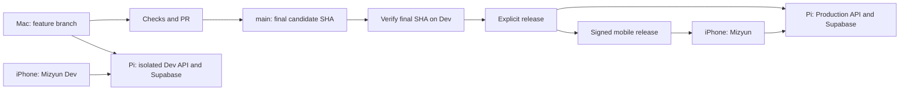

# Development and production on the Mac, Raspberry Pi, and iPhone

> Implementation reviewed 2026-09-08: both Pi stacks now exist, but this guide is not fully satisfied. See [the review](../IMPLEMENTATION_REVIEW_2026-09-08.md) for observed paths, unresolved runtime/build/deploy defects and outstanding acceptance. The original target and checklist below are retained as requirements, not proof of completion.

> Implementation guide prepared 2026-09-07. **Target configuration, not an installed setup.** The user requested both backends on the Raspberry Pi, both app variants on the iPhone, and one maintainable Mac codebase. Read the current [release audit](../RELEASE_READINESS_2026-09-07.md) alongside this guide. Environment isolation does not itself make the app ready for external testers or App Store release.

## 1. Recommended approach

Use **one Git repository, short feature branches, two isolated backend environments, and two app identities**. Keep production pinned to an explicitly released commit. Development can advance independently. Promote code and reviewed database migrations; never merge development records into production.

A common small-team workflow is a short-lived branch, automated checks, a pull request, testing, merge into `main`, and an explicit deployment. GitHub documents this branch/review/merge pattern. Larger teams often add dedicated staging and temporary preview environments. For Mizyun, the Pi development stack can serve as the release-candidate environment during a short testing freeze; a third always-on stack is unnecessary initially. This is a recommendation for this project, not a universal company standard. [GitHub flow](https://docs.github.com/en/get-started/using-github/github-flow).

Avoid a permanent `development` branch plus a permanent `production` branch for now. They create another synchronization problem for one founder. `main` is the integration/releasable branch; production is an exact deployed SHA plus a release record. Merging is not automatically deploying.



Both services living on one Pi gives environment separation, **not independent failure domains**. A host crash, disk failure, or resource exhaustion can affect both. Keep the existing infrastructure evolution gates before outside reliance and paying-user production. If capacity tests fail, stop adding load and document a concrete capacity change; do not silently move production or share its database to save RAM.

## 2. What exists, and what must change

Existing pieces:

- `apps/mobile/app.config.js` defines `com.mizyun.dev` / `mizyun-dev` and `com.mizyun.app` / `mizyun`.
- Production API and Auth are reachable at `mizyun-api.phiskel.com` and `mizyun-supabase.phiskel.com`.
- Pi production checkout is documented as `/home/mizyun/mizyun` → `/var/lib/mizyun/repo`; templates use `/etc/mizyun/production.env`, `/srv/mizyun/supabase`, and `mizyun-api.service`. Inspect live paths before trusting old templates.
- Mac checks and exact-commit production promotion scripts exist. Windows remains the hot backup.

Gaps found while preparing this guide:

- No verified second Pi API/Supabase environment, resource measurements, or environment-specific deployment commands.
- EAS profiles do not explicitly select the production variant. Preview/development profiles lack the complete intended configuration. `expo-dev-client` is not in the app dependency manifest.
- **Tailscale and SSH connectivity**: Remote access to `rpserver` relies on Tailscale. Both the Mac and the Raspberry Pi 5 must be connected to Tailscale. The Mac's `~/.ssh/config` maps `rpserver` to the Pi's Tailscale IP or MagicDNS hostname (e.g. `mizyun-pi`). If SSH fails, first verify Tailscale status (`tailscale status`) on the Mac and ensure the Pi is online in Tailscale before touching keys or sshd.
- **`pnpm deploy:remote <sha>` currently ignores the positional SHA**: the script reads local `HEAD`. It requires clean `main`, pushes, and runs `pnpm db:verify` even if no schema changed. Future tooling must implement its advertised exact-SHA contract rather than copy this invocation blindly.
- Remote promotion defaults, service names, backup scripts, and old CI assume one environment. A Compose project name alone will not fix hard-coded Supabase container names or bind-mounted directories.

The current AGENTS.md per-commit production-promotion rule needs an explicit amendment during implementation: feature commits go to Dev, and only accepted releases go to Production. The user's requested workflow is the reason for that change. Until the new tooling and rule are adopted, this document must not be treated as evidence that the old command can safely target Dev.

## 3. Environment inventory to implement

New names and ports below are proposed defaults; verify DNS ownership, live ports, and capacity first. Preserve production names/paths during the initial rollout to avoid unnecessary migration risk.

| Concern                      | Production                                     | Development                                            |
| ---------------------------- | ---------------------------------------------- | ------------------------------------------------------ |
| iPhone name                  | Mizyun                                         | Mizyun Dev, clearly different icon/badge               |
| iOS bundle / Android package | `com.mizyun.app`                               | `com.mizyun.dev`                                       |
| Auth app callback            | `mizyun://auth/callback`                       | `mizyun-dev://auth/callback`                           |
| Public API                   | Existing `https://mizyun-api.phiskel.com`      | Proposed `https://mizyun-api-dev.phiskel.com`          |
| Public Supabase gateway      | Existing `https://mizyun-supabase.phiskel.com` | Proposed `https://mizyun-supabase-dev.phiskel.com`     |
| Pi API listener              | Verify existing, expected `127.0.0.1:4000`     | Proposed `127.0.0.1:4100`                              |
| Pi gateway listener          | Verify existing, expected `127.0.0.1:8000`     | Proposed `127.0.0.1:8100`                              |
| API service                  | Preserve `mizyun-api.service`                  | New `mizyun-api-dev.service`                           |
| Supabase service             | Preserve `mizyun-supabase.service`             | New `mizyun-supabase-dev.service`                      |
| Code                         | Preserve production checkout                   | New `/var/lib/mizyun/dev/repo`                         |
| Supabase files/data          | Preserve `/srv/mizyun/supabase`                | New `/srv/mizyun/dev/supabase`                         |
| Server secrets               | Preserve `/etc/mizyun/production.env`          | New `/etc/mizyun/dev.env`                              |
| Compose project              | Inspect/preserve existing                      | Explicit `mizyun-dev`                                  |
| Accounts/data                | Real production users                          | Separate synthetic test accounts/data                  |
| AI/email credentials         | Production-scoped                              | Separate development scope, quotas and test recipients |
| Release identity             | Recorded production SHA                        | Recorded development SHA                               |

The same email can create two unrelated accounts with different user IDs and passwords. Dev sign-out, deletion, upload, migration, and reset must have no effect on Production. Use independent Auth signing keys and API keys, not just different database schemas or a `dev` flag in shared tables.

## 4. Mac code and tooling

Keep `/Users/adam/Documents/mizyun` as the primary working repository. Pin/verify the supported Node release, pnpm `10.33.0`, Expo SDK 57 / React Native 0.86, Xcode and Android toolchains; install with the existing lockfile rather than upgrading everything as part of this work. Use the [SDK 57 documentation](https://docs.expo.dev/versions/v57.0.0/) and existing platform runbooks to confirm compatibility.

Mac duties:

1. Edit code, run `pnpm check`, and run Metro for fast UI iteration.
2. Build iOS locally with Xcode or through EAS. The Pi cannot build iOS binaries; it runs backends.
3. Run a **disposable local Supabase stack only for clean migration/RLS verification or focused debugging**. It is not the everyday backend.
4. Deploy committed feature code to Pi Dev for persistent mobile/API integration testing.

One working directory is sufficient if switching branches is convenient. For simultaneous feature work and release inspection, create a second Git worktree; it shares history but has a separate checkout, dependencies, generated native directories, and ignored environment files. Do not copy the repository folder manually. [Git worktrees](https://git-scm.com/docs/git-worktree).

Example after preserving/committing current work and choosing an available branch name:

```bash
git worktree add -b codex/example-feature ../mizyun-feature main
```

The primary worktree can keep `main`; the second holds the feature branch. A branch ordinarily cannot be checked out in both simultaneously. Install dependencies separately. Do not transfer production server secrets or databases into either worktree.

### Mobile build configuration

Create guarded mobile commands that select exactly one reviewed environment file and disable Expo's implicit dotenv loading for local builds. The file should contain only the four currently allowed public values:

```dotenv
# Example only: proposed Dev URLs; public key must come from DEV Auth.
EXPO_PUBLIC_API_URL=https://mizyun-api-dev.phiskel.com
EXPO_PUBLIC_SUPABASE_URL=https://mizyun-supabase-dev.phiskel.com
EXPO_PUBLIC_SUPABASE_PUBLISHABLE_KEY=<dev-publishable-key>
EXPO_PUBLIC_AUTH_REDIRECT_URI=mizyun-dev://auth/callback
```

The wrapper sets `MIZYUN_APP_VARIANT=dev` separately; production uses `production` and the existing production URLs/callback. Use app config `extra` for any new build metadata unless the strict public-env allowlist is deliberately extended. Never add Gemini, database, SES, service-role, or tunnel credentials to a mobile environment file.

For EAS, provision explicit development/preview/production environment selections and every required public value, including the publishable key. `MIZYUN_APP_VARIANT` must be available when app config is evaluated, not hidden in a secret unavailable to that stage. Verify the effective configuration and generated artifact; do not rely on `.env.local` or `NODE_ENV` to select the business environment. [EAS environment variables](https://docs.expo.dev/eas/environment-variables/).

## 5. Pi implementation sequence

### Phase A — Inventory and protect existing production

Restore the existing SSH access without weakening authentication. Read-only inspection should establish:

- actual host architecture, RAM, swap, disk/filesystem health and free space;
- production SHA, dirty state, resolved checkout path and systemd units;
- current CPU/RAM/I/O and latency under normal load;
- Compose release/image versions, published ports, container names, networks, named volumes, bind mounts and health checks;
- existing tunnel/DNS ownership, listeners, Auth redirects and SMTP configuration;
- last verified backup, separate backup destination, retention, restore evidence and rollback procedure.

Safe inventory examples after access works:

```bash
ssh rpserver 'free -h'
ssh rpserver 'df -h'
ssh rpserver 'docker stats --no-stream'
ssh rpserver 'docker ps --format "table {{.Names}}\t{{.Ports}}\t{{.Status}}"'
ssh rpserver 'systemctl status mizyun-api mizyun-supabase --no-pager'
```

Do not print full service environments, Docker inspection environments, or rendered Compose configurations into session logs; those can contain secrets. Save only redacted inventory. Before changes that can affect production, verify database **and Storage** backup/restore in an isolated destination. Disable/replace the unsafe persistent-host reset workflow identified by R9 in the release audit.

**Exit:** known-good production baseline, accessible recovery path, and measured capacity budget for Dev. Reserve production headroom. Set bounded Dev CPU/RAM/process usage and disk/log limits; demonstrate that a Dev restart or stress test cannot starve production. Two complete Supabase stacks may exceed this Pi's practical capacity; its RAM was not verified here.

### Phase B — Create a genuinely separate Dev stack

Use the official self-hosted Supabase Docker distribution pinned to a reviewed release. Preserve the existing production distribution. Validate ARM64 support for every Dev image. Start with a full compatible service graph, then remove optional services only with documented dependency analysis and acceptance. [Supabase Docker self-hosting](https://supabase.com/docs/guides/self-hosting/docker).

Implement a checked-in, non-secret Dev Compose overlay or deterministic renderer. The future session must account for **all** collisions:

- hard-coded `container_name`, `hostname`, internal references and dependencies;
- every host port, including gateway HTTPS, database/pooler, Studio, analytics and other optional services;
- external network names, explicit volume names and all host bind paths;
- Auth/JWT/signing/API keys, database passwords, gateway configuration and storage ownership;
- dashboard credentials and encryption keys used by installed Supabase components.

Project naming helps scope Compose resources, but it does not relocate a shared bind mount or override explicit global names. Check the rendered resource graph privately before creating anything. Never reuse production database or Storage mounts. [Compose project names](https://docs.docker.com/compose/how-tos/project-name/).

Keep Dev database/Studio/management endpoints private. Bind gateway/API host listeners to loopback for the local tunnel. Apply migrations to the new empty Dev database and seed only synthetic fixtures. Run the Dev API as a separate unprivileged Linux user, with no read access to production secrets/data and no Docker socket access. Keep Docker administration in the deployment/operator boundary with narrowly scoped service operations. Docker-daemon membership is effectively administrative and is not a security boundary against a malicious Dev process.

Create `mizyun-supabase-dev.service` and `mizyun-api-dev.service` with explicit directories, credentials, dependencies, restart behavior, and resource limits. A Dev deploy must restart only Dev. Use a separate checkout pinned to a committed SHA, not a shared production checkout or an SSH edit session.

For a remotely deployed candidate, `NODE_ENV=production` is appropriate even for the **Dev environment**: it retains persistent-configuration guards and avoids watch/debug runtime behavior. Add a separate validated deployment label such as `MIZYUN_ENV=development|production` as implementation work, and use it for target safeguards. It does not exist in the current configuration schema. Keep synthetic/fake-provider unit tests under test configuration; do not weaken production guards to make Dev work.

**Exit:** Dev local API/Auth/Storage work, restart cleanly, and have no production mounts, credentials, token acceptance, or side effects.

### Phase C — HTTPS, Auth and provider boundaries

Create the proposed Dev API and Supabase hostnames only after verifying ownership. Prefer a separate Dev tunnel/service/credential so Dev route changes need not restart the production tunnel. Route each hostname only to its corresponding local listener. An ingress route is not authorization. [Cloudflare tunnel configuration](https://developers.cloudflare.com/cloudflare-one/networks/connectors/cloudflare-tunnel/do-more-with-tunnels/local-management/configuration-file/).

For this founder-only Dev surface, enforce an invite-only Auth configuration or explicit server-side allowlist, verify every protected endpoint still checks the principal, and rate-limit public Auth/API paths. If choosing network-private Dev instead, document and test iPhone Tailscale/HTTPS and OAuth/email/browser reachability end to end. Do not place a browser-only Cloudflare Access login in front of native bearer-token traffic without a tested native integration.

Configure independent Auth projects:

- Dev permits only `mizyun-dev://auth/callback` and explicitly required Dev browser/OAuth URLs.
- Production permits `mizyun://auth/callback` and required production URLs, without broad development wildcards.
- Set the self-hosted external/API URL and gateway routing so signed Storage URLs point to the correct **public environment hostname**, not a loopback address unreachable from the phone.
- Google OAuth redirects back to that environment's Supabase `/auth/v1/callback`, then Auth returns to the app scheme. Use separate OAuth clients where possible. Apply the equivalent environment-specific setup for Sign in with Apple.
- Test confirmation, password recovery and OAuth both from cold start and while the other app variant is open. The browser redirect configuration and mobile callback are distinct parts of the flow. [Supabase redirect URLs](https://supabase.com/docs/guides/auth/redirect-urls).

Use separate AI keys/projects or enforce independently measurable Dev budgets. Use separate SMTP credentials/limits and test recipients; label test mail clearly. Never copy real food logs, body photos, chats or backups into Dev. Account isolation does not give permission to send tester data to an unevaluated AI provider. Retain the founder exception and the external AI gate from the release audit.

**Exit:** Dev works from the iPhone over the intended network, rejects production tokens, uses Dev media URLs, and cannot send mail or consume budgets through production credentials.

## 6. Two iPhone apps, three useful build profiles

| Build profile | Installed identity | Backend       | Requires Mac Metro?        | Intended use                                                      |
| ------------- | ------------------ | ------------- | -------------------------- | ----------------------------------------------------------------- |
| `development` | `com.mizyun.dev`   | Pi Dev        | Usually yes during editing | Fast Refresh, debugging and feature development                   |
| `preview`     | `com.mizyun.dev`   | Pi Dev        | No; embedded JS            | Founder testing away from Mac, realistic release-style acceptance |
| `production`  | `com.mizyun.app`   | Pi Production | No                         | TestFlight/store-distributed release                              |

The development client and standalone preview use the **same Dev identity**, so installing one replaces the other. They both coexist with Production. If simultaneous Dev-client and preview installs later become necessary, introduce a third explicit identity; that is not needed for the requested two-app setup.

Configure `developmentClient: true` for the development profile and install a compatible `expo-dev-client`. Use `distribution: internal` and a standalone Release build for preview. Register the founder iPhone for internal iOS distribution and configure signing using the actual paid Apple team. Native dependency/plugin/capability changes require rebuilding; JavaScript edits can use Metro. A development client connected to the Mac cannot provide the same Mac-off guarantee as a standalone preview. [Expo development builds](https://docs.expo.dev/develop/development-builds/introduction/), [internal distribution](https://docs.expo.dev/build/internal-distribution/).

Keep Dev visually distinct, with a persistent Dev indicator and a support/build-information screen showing environment, app version/build, source SHA, and server release. Do not add a production-user endpoint switch. Validate bundle IDs, schemes, endpoints, public keys and capability entitlements before packaging. Do not automatically share Keychain groups, containers, or sessions between variants.

EAS app/project IDs must be configured and verified for the chosen variant model. They are not currently present in checked-in config. Register distinct native identifiers in the Apple developer account. The production identifier keeps one App Store Connect record; Dev may use internal distribution without its own public listing. A production TestFlight build and an App Store build with the same bundle ID occupy the same app identity, not two side-by-side apps.

The current config disables the notifications plugin for Dev. Review that behavior deliberately: tests requiring the native notifications module/capability need a compatible Dev binary. Do not carry the old Personal Team workaround into a store build, and do not introduce remote push infrastructure solely for the existing local reminders.

**Do not add EAS Update during the initial isolation work.** Once ordinary builds/releases are reliable, it can be evaluated separately with environment-specific channels and compatible runtime versions. Publishing a JavaScript update must never silently retarget production users to Dev or introduce unsupported native modules.

## 7. Release tooling to implement before using the new workflow

These are **proposed command contracts, not existing commands**:

```text
pnpm deploy:dev <full-sha>
pnpm deploy:production <full-sha>
pnpm mobile:dev
pnpm mobile:preview:ios
pnpm mobile:production:ios
pnpm env:verify
```

`deploy:dev` must fetch a pushed commit from the canonical repository, validate its exact SHA/ref, apply only Dev migrations, restart only Dev, and record acceptance/build identity. One shared Dev database cannot safely run incompatible branches concurrently; serialize deployments and freeze the candidate while testing it.

`deploy:production` must accept and verify the supplied full SHA, require it to be an accepted `origin/main` commit, check the relevant evidence, and never silently substitute `HEAD`. If it differs from the checkout, run verification in an isolated checkout of that SHA. It should not unexpectedly push unrelated commits. Use an explicit non-secret target manifest with fixed host/path/service/DB identity mappings. Fail closed on missing or conflicting environment values; do not use a production-default env file for a Dev invocation.

For both commands:

- lock per environment to prevent overlapping deployments/migrations;
- verify commit availability, lockfile and actual runtime installation;
- maintain separate migration histories and check pending migrations against the target database ledger, not only Git differences;
- record old/new SHA and migration identifiers without credentials;
- back up before production changes, preview migrations, and apply only forward migrations;
- validate application readiness plus authenticated synthetic functionality, not just the static health route;
- roll code back only where the database/API contract remains compatible;
- scope archive, log and release cleanup so it cannot remove the other environment;
- never run `db:verify`, `db:reset`, broad Compose teardown, or volume pruning on the Pi authority.

Prefer installing a release into a separate directory and switching an environment-specific `current` pointer over installing dependencies in the running checkout. This requires a deliberate production migration plan and service update; it must not be slipped into initial Dev provisioning. The first implementation can retain the existing production checkout with explicit known limitations and rollback checks.

CI should run the full application gate and clean database/RLS verification in disposable workers, with production deployment credentials unavailable to ordinary PR code. Adapt branch protection for a solo founder: require checks and review the diff, but do not invent an unavailable second reviewer. Use an explicit production deployment gate and narrow deploy permissions. The existing self-hosted reset workflow must not target either durable Pi environment.

## 8. Daily feature-to-production workflow

After the scripts and policy updates above are implemented:

1. Start from current `main` and create `codex/<feature>`. Preserve any unrelated working-tree edits before switching.
2. Implement on the Mac. Run focused tests and `pnpm check` before committing. For migrations, run `pnpm db:verify` only against a clean disposable Mac/CI database.
3. Push the feature branch, deploy that exact SHA to Pi Dev, and test with Mizyun Dev. Metro accelerates UI work; use the standalone preview for restart, network, background and Mac-off acceptance.
4. Review the PR and merge into `main` when checks and feature acceptance pass. Record the **resulting main SHA**; squash/rebase/merge may produce a different commit than the previously tested branch.
5. Deploy that resulting SHA to Dev and verify the final candidate. Freeze Dev during this acceptance window. The production and Dev mobile artifacts have different configuration/signatures, so equal source SHA does not mean byte-identical binaries.
6. Promote the final accepted SHA's API and any backward-compatible migrations to Production explicitly. A push or merge alone must not change the live service.
7. Build a signed production mobile artifact from the same accepted source when mobile changes require a release. Test the actual production configuration through TestFlight/Play with disposable synthetic accounts, then submit/release. API-only compatible changes need not force a mobile rebuild.
8. Record server SHA, app build numbers, migrations, device evidence, monitoring and rollback point in `status.md`. Resume feature work on a new branch.

Production can remain on yesterday's accepted release while `main` and Dev advance. For an urgent fix, prefer a small fix on releasable `main`; if unreleased main changes make that unsafe, branch from the deployed release, then bring the fix back into main and follow a documented exceptional release procedure. Do not leave two diverging permanent product branches.

## 9. Database changes and old mobile versions

Mobile releases do not reach every phone at once. Keep the production API/database compatible with the previous supported app version.

Use an expand–migrate–contract sequence. For example, add a new nullable column/default and retain old fields; deploy code that handles both shapes; ship the new app; backfill if needed; remove the old contract only after its support window closes. A backward-incompatible rename/drop cannot be made safe merely by testing the new app against Dev.

Dev migration success is necessary but not sufficient: verify a clean install **and** upgrade from the currently deployed schema with synthetic fixtures. Test old-client/new-server and new-client/new-server behavior. Never repair a published migration by editing it in place; add a forward migration.

Rollback normally restores a compatible API/mobile version, not the database. Restoring a production backup can discard writes made afterward and is an incident-recovery decision. Do not automate destructive database rollback as the response to an API health failure. Store-distributed app rollback is not an instant server-side switch; preserve old API behavior and feature kill switches.

## 10. Acceptance checklist for the future implementation session

- [ ] Pi inventory/access/capacity and production recovery baseline recorded.
- [ ] Dev and Production have different DB/Auth/Storage/keys/mounts/listeners/services and explicit deployment targets.
- [ ] Production token against Dev and Dev token against Production both fail; same-email accounts remain independent.
- [ ] Dev data creation/edit/deletion, service restart and deployment leave production release and synthetic sentinel records unchanged.
- [ ] Any future Dev reset procedure is explicitly scoped and tested against a disposable rehearsal stack first; no reset is run on the durable Pi as part of this checklist.
- [ ] Fresh signup/invite, confirmation, recovery, Google/Apple login, session restoration, signed photo transfer and deletion work per environment.
- [ ] Mizyun and Mizyun Dev coexist on iPhone with matching identities, visible environment and isolated sessions.
- [ ] Standalone Dev preview and Production work with the Mac off; ordinary Dev-client Metro dependence is documented.
- [ ] Final accepted SHA and both application/server configurations are inspectable and recorded.
- [ ] Development resource stress cannot breach the recorded production baseline; backups/monitoring remain healthy.
- [ ] Full Mac checks and appropriate clean schema/RLS/upgrade gates pass; no real records copied to Dev.
- [ ] Dev deploy, production release, invalid-target rejection, concurrency lock and compatible rollback are verified.
- [ ] AGENTS.md, ADR-0018 successor, roadmap/status/backlog, env examples, tutorials and scripts describe the adopted workflow consistently.
- [ ] Separate friends-beta blockers from the release audit remain tracked; do not mark App Store readiness merely because isolation works.

## 11. Suggested implementation work packages

| Package        | Deliverable                                                                       | Dependency                                             |
| -------------- | --------------------------------------------------------------------------------- | ------------------------------------------------------ |
| INFRA-DUAL-001 | Read-only Pi inventory, access recovery, resource plan and adopted decision       | Existing operator access; production recovery evidence |
| INFRA-DUAL-002 | Independent Dev Supabase/API/services, hosts and synthetic acceptance             | 001 capacity/recovery gate                             |
| INFRA-DUAL-003 | Guarded build profiles and both iPhone identities; Metro and standalone Dev modes | 002 Dev endpoint/Auth configuration                    |
| INFRA-DUAL-004 | Exact-SHA Dev/release scripts, safe CI, migration and rollback checks             | 002; current unsafe remote-reset path removed          |
| INFRA-DUAL-005 | Full isolation/device/Mac-off/load acceptance and canonical documentation handoff | 003 and 004                                            |

Implement in bounded sessions and record the next exact action after each. Do not activate production auto-deployment as a shortcut.

## 12. Prompt to resume this work

> Implement the target in `docs/tutorials/DEV_PRODUCTION_PI_GUIDE.md`, starting with INFRA-DUAL-001. Read AGENTS.md, goals, business alignment, plan, status, backlog, ADR-0020, and the release audit first. Preserve existing uncommitted work. Restore existing Pi SSH access and inventory production/resources/backups before provisioning anything. Build an isolated Pi Dev backend and two iPhone variants from one repository, with feature branches and explicit exact-SHA production releases. Keep production records and endpoints intact, never reset a persistent Pi database, and never copy real user data into Dev. The requested workflow supersedes automatic promotion of every feature commit; update the canonical rule when adopting and verifying the new tooling. Follow the work-package dependencies, recheck current official docs, and record evidence. A working dual environment does not close the separate friends-beta/AI/store gates.
